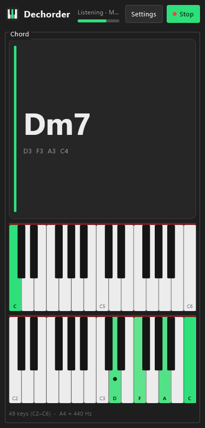
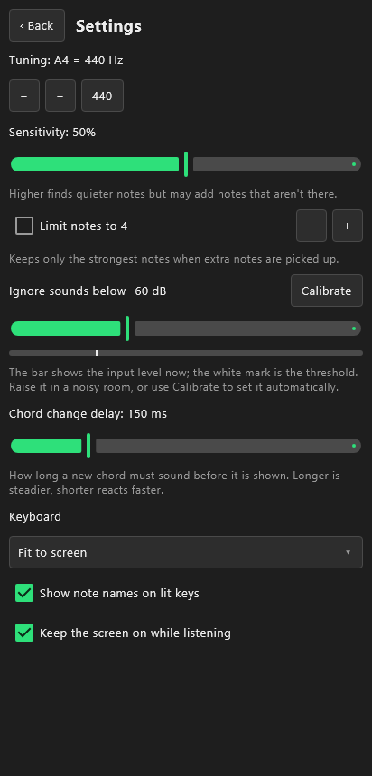

# Dechorder

Listens through the microphone, names the chord being played and lights up its notes on a piano
keyboard. Runs on Android phones/tablets and on the desktop (Windows, macOS, Linux) from one Kotlin
codebase (Kotlin Multiplatform + Compose Multiplatform) and is fully offline.

<table>
  <tr>
    <td></td>
    <td></td>
  </tr>
</table>

## How it works

`composeApp/src/commonMain/kotlin/app/dechorder/`

| Package  | What                                                                                           |
|----------|------------------------------------------------------------------------------------------------|
| `dsp`    | FFT, spectral peaks (8192-sample Hann window, hop 2048), polyphonic note detection by harmonic salience with iterative cancellation |
| `music`  | Note names and chord naming: every root × quality (triads, 6ths, 7ths, 9ths, sus, power chords…) is scored against the notes heard; the lowest note decides inversions (C/E) |
| `engine` | Smooths notes over frames, settles the displayed chord (it changes once a new chord has sounded for the "chord change delay"; a fading chord is not mistaken for a new one) |
| `ui`     | Compose UI with a dark theme: chord display, piano keyboard, settings                          |

Platform code: `androidMain` (AudioRecord, unprocessed mic source) and `desktopMain` (Java Sound;
any capture device can be chosen, including "Stereo Mix" to analyse the computer's own playback).

## Build and run

Requires JDK 17+ (the Gradle daemon uses JDK 21, see `gradle/gradle-daemon-jvm.properties`).

```
gradlew :composeApp:run                         # desktop app
gradlew :composeApp:desktopTest                 # tests (synthesised piano chords through the whole pipeline)
gradlew :composeApp:packageDistributionForCurrentOS   # installer (.msi needs WiX on Windows)
gradlew :composeApp:createDistributable         # app folder with its own runtime, no installer
```

### Android

The Android target is built only when an Android SDK is configured (`sdk.dir` in `local.properties`,
or `ANDROID_HOME`). Opening the project in Android Studio / IntelliJ with the Android plugin sets this
up. Then:

```
gradlew :composeApp:assembleDebug               # composeApp/build/outputs/apk/debug/composeApp-debug.apk
gradlew :composeApp:installDebug                # install on a connected phone (USB debugging on)
```

The release build is signed with the debug key so it can be side-loaded; use your own key before
publishing.

## Settings

- **Input** (desktop): microphone or another capture device.
- **Tuning**: reference A4 (415–466 Hz) for instruments not tuned to 440 Hz.
- **Sensitivity**: higher finds quieter notes but may add notes that aren't there.
- **Ignore sounds below**: noise gate; raise it in a noisy room.
- **Chord change delay**: how long a new chord must sound before it is shown.
- **Keyboard**: 37 to 88 keys, or fit to the screen; note names on lit keys. On a phone held upright the
  keyboard is split into two rows (treble above bass) so the keys are big enough to read.

## LLMs used for development

- Claude Opus 5.5
